<!-- Header -->
<p align="center">
  
</p>

<p align="center">
  <a href="https://github.com/gaurav02081">
    
  </a>
</p>

<p align="center">
  <a href="https://www.linkedin.com/in/gaurav-karmakar-800a08375/"></a>
  <a href="mailto:gauravkarmakar0987@gmail.com"></a>
  <a href="https://github.com/CCExtractor"></a>
  
</p>

---

### `$ whoami`

```python
class Gaurav:
    role      = "Forward Deployed Engineer @ Graeon (IIT Bombay startup)"
    based_in  = "India 🇮🇳"
    ships     = ["computer vision for industrial automation", "RAG systems", "CLIs for AI agents"]
    open_src  = "Google Summer of Code 2026 @ CCExtractor"
    stack     = ["Python", "OpenCV", "PyTorch", "LangChain", "Flask", "Django", "React", "TypeScript", "Docker"]

    def now(self):
        return [
            "taking CV + RAG systems from a notebook to a customer's site",
            "maintaining sp, the CLI for CCExtractor's CI platform",
            "learning in public, one merged PR at a time",
        ]
```

---

### 🛠️ Open source work

| Project | What I built |
|---|---|
| 🧪 **[CCExtractor/sp_cli](https://github.com/CCExtractor/sp_cli)** | **`sp`**: my GSoC 2026 project. A CLI so a developer *or an AI agent* can investigate CI failures on CCExtractor's [Sample Platform](https://sampleplatform.ccextractor.org) from the terminal: no web UI, no HTML scraping. JSON-first, failures auto-classified. |
| 🎯 **[Smart diff](https://github.com/CCExtractor/sample-platform/pull/1142)** | Semantic diff for caption outputs. Instead of *"53 lines differ"* it says *"All 13 cues match but are 500 ms late."* Served from the API and the new web console. |
| 🐞 **CI bugs found with data** | [#1176](https://github.com/CCExtractor/sample-platform/issues/1176): PR runs record a commit that was never built · [#1177](https://github.com/CCExtractor/sample-platform/issues/1177): a run can report `pass` after testing 1 of 237 samples |
| 🎬 **[CCExtractor](https://github.com/CCExtractor/ccextractor)** | [FFmpeg/libavformat backend for MP4 demuxing](https://github.com/CCExtractor/ccextractor/pull/2191) · [macOS arm64/x86_64 hardsub build fix](https://github.com/CCExtractor/ccextractor/pull/2073) · [panic fix for `--mp4`/`--mkv`](https://github.com/CCExtractor/ccextractor/pull/2107) · [EIA-608 rollup timing fix](https://github.com/CCExtractor/ccextractor/pull/2268) |
| ⚡ **[sample-platform](https://github.com/CCExtractor/sample-platform)** | [Sample history paginated in SQL](https://github.com/CCExtractor/sample-platform/pull/1167) (was timing out with a 504 on production data) |

### 🚀 Projects

| Project | What it is |
|---|---|
| 👁️ **[AI Vision Lab](https://github.com/gaurav02081/ai-vision-project)** | Computer vision experiments, from classic OpenCV to deep learning |
| 💪 **[Push-up Tracker AI](https://github.com/gaurav02081/push-up-tracker-ai)** | Real-time push-up counter: MediaPipe pose tracking, rep counting from elbow angle, session logs |
| 🛒 **[MERN e-commerce](https://github.com/gaurav02081/clientproj)** | Full-stack store for a client |

---

### 🧰 Tech stack

<p align="center">
  
</p>

---

### 📊 GitHub stats

<p align="center">
  
  
</p>

### 🎥 Live from the vision pipeline

<p align="center">
  
</p>

### 🐍 Eating my contributions

<p align="center">
  <picture>
    <source media="(prefers-color-scheme: dark)" srcset="https://raw.githubusercontent.com/gaurav02081/gaurav02081/output/github-snake-dark.svg" />
    <source media="(prefers-color-scheme: light)" srcset="https://raw.githubusercontent.com/gaurav02081/gaurav02081/output/github-snake.svg" />
    
  </picture>
</p>

<!-- Footer -->
<p align="center">
  
</p>
